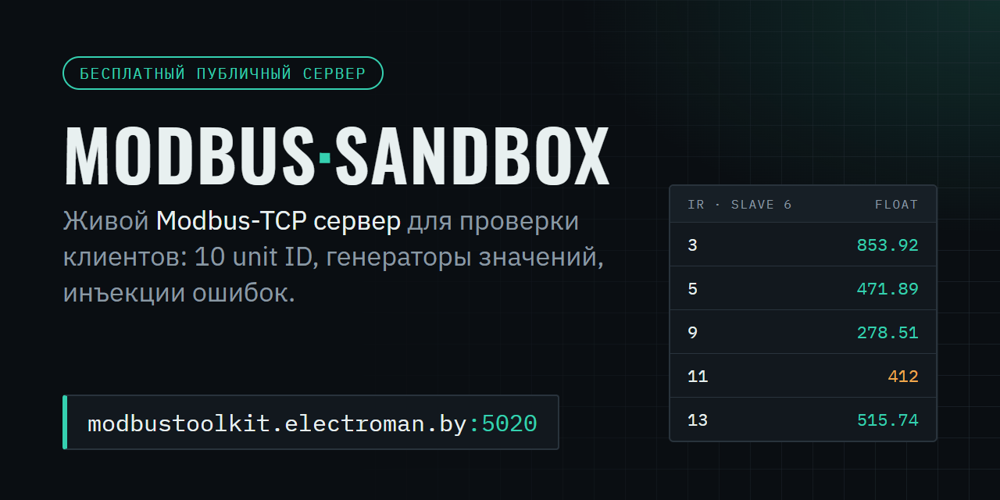
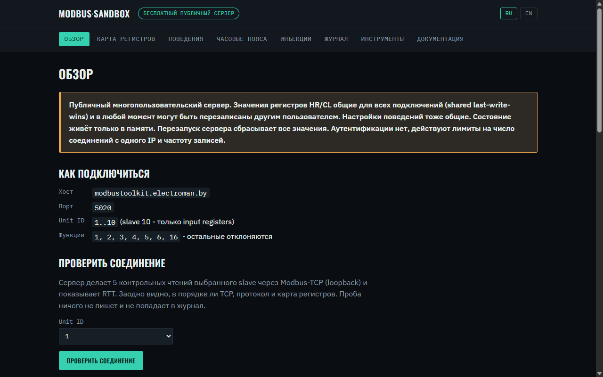
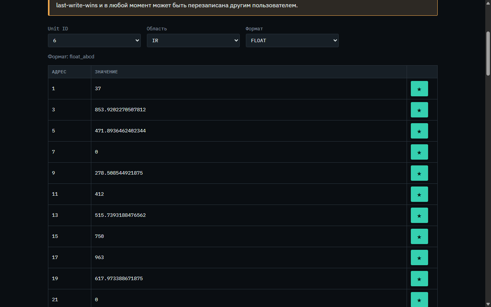
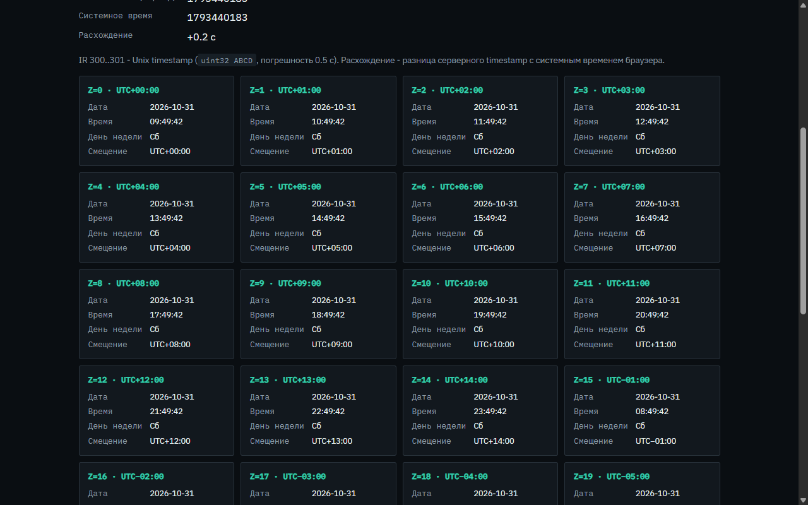
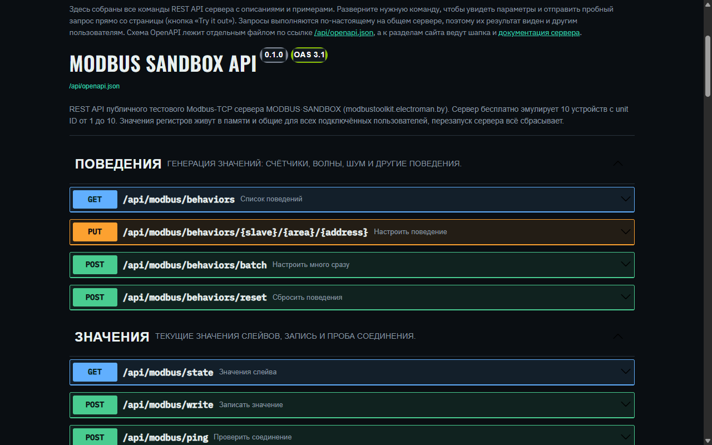

<p align="center">
  
</p>

<p align="center">
  <a href="https://github.com/StarLeG/modbustoolkit-sandbox/actions/workflows/ci.yml"></a>
  
  
  
  <a href="https://modbustoolkit.electroman.by"></a>
</p>

<p align="center">
  <b>Живой Modbus-TCP сервер, к которому можно подключиться прямо сейчас.</b><br>
  Регистры меняются сами, ошибки инжектятся по кнопке, ничего ставить не нужно.
</p>

## Подключиться за минуту

| Параметр | Значение |
|---|---|
| Хост | `modbustoolkit.electroman.by` |
| Порт | `5020` |
| Unit ID | `1..10` (slave 10 отдаёт только input registers) |
| Функции | `1, 2, 3, 4, 5, 6, 16`, остальные получают Illegal Function |
| Web UI | [modbustoolkit.electroman.by](https://modbustoolkit.electroman.by) |

Проверка из Python:

```python
from pymodbus.client import ModbusTcpClient

client = ModbusTcpClient("modbustoolkit.electroman.by", port=5020)
client.connect()
print(client.read_input_registers(1, count=8, device_id=1).registers)
client.close()
```

Примеры для Node.js и C#, а также пошаговое руководство для настольного
[ModbusToolkit](https://modbustoolkit.electroman.by) лежат в разделе
«Документация» на сайте.

## Что умеет

- **10 устройств с разными форматами.** uint16, uint32 и float во всех четырёх
  порядках слов (ABCD, CDAB, BADC, DCBA). Удобно ловить перепутанный byte order
  у своего клиента.
- **Значения живут сами.** Движок поведений крутит счётчики, пилу, синус,
  меандр, шум и ещё десяток генераторов. Любой регистр можно перенастроить из UI.
- **Инъекции ошибок.** Exception-коды, таймауты и мусор в ответах с ограниченным
  временем жизни. Так видно, как клиент переживает нештатную связь.
- **Часовые пояса на slave 10.** Дата и время по 27 зонам плюс Unix timestamp:
  проверка чтения времени и «дырок» в блоках регистров.
- **Многопользовательский режим.** Наладчики подключаются одновременно, записи
  в HR и CL общие для всех (last-write-wins).
- **Web UI на русском и английском.** Live-карта регистров, журнал событий,
  снимки с восстановлением, графики и генератор конфигов для популярных клиентов.
- **REST API и метрики.** Swagger на `/api/docs`, Prometheus на `/metrics`,
  healthcheck на `/healthz`.

## Как это выглядит

<table>
  <tr>
    <td width="50%"></td>
    <td width="50%"></td>
  </tr>
  <tr>
    <td align="center"><sub>Обзор и параметры подключения</sub></td>
    <td align="center"><sub>Живая карта регистров (slave 6, float)</sub></td>
  </tr>
  <tr>
    <td width="50%"></td>
    <td width="50%"></td>
  </tr>
  <tr>
    <td align="center"><sub>Slave 10: 27 часовых поясов и Unix timestamp</sub></td>
    <td align="center"><sub>REST API в оформлении сайта</sub></td>
  </tr>
</table>

## Карта слейвов

| Slave | Формат HR/IR | Адреса HR и IR | CL / DI |
|---|---|---|---|
| 1 | uint16 | 1..1024 | 1..64 |
| 2 / 3 / 4 / 5 | uint32 ABCD / CDAB / BADC / DCBA | 1, 3, …, 1023 | 1..64 |
| 6 / 7 / 8 / 9 | float ABCD / CDAB / BADC / DCBA | 1, 3, …, 1023 | 1..64 |
| 10 | uint16, только IR | 1..268 (часовые пояса), 300..301 (Unix timestamp) | нет |

Полная спецификация с раскладкой байтов лежит в [docs/HRIR_SPEC.md](docs/HRIR_SPEC.md).

Правила общего сервера простые. HR и CL может перезаписать любой участник.
Демо-слоты (верхние регистры HR и витрина генераторов в IR) заблокированы,
запись туда отклоняется с кодом 0x04. IR и DI сервер всегда генерирует сам.
Запись функцией 16 ограничена двумя регистрами. Перезапуск сбрасывает все
значения: на диск ничего не пишется.

Три готовых сценария проверки клиента (uint32 CDAB, реакция на timeout,
float DCBA) собраны в [docs/DEMO.md](docs/DEMO.md).

## Свой сервер

Локально:

```bash
uv sync
uv run python -m app
```

Web UI откроется на http://127.0.0.1:8765, Modbus слушает порт 5020.

В Docker:

```bash
docker compose up -d --build
```

Для своей инсталляции задайте `MODBUS_PUBLIC_HOST`, тогда UI и генератор
конфигов покажут ваш адрес. Все переменные окружения перечислены
в [.env.example](.env.example). Варианты с nginx и systemd, мониторинг и
лимиты описаны в [docs/DEPLOY.md](docs/DEPLOY.md), модель угроз
в [docs/SECURITY.md](docs/SECURITY.md).

## Стек

Python 3.11 и новее, asyncio, [pymodbus](https://github.com/pymodbus-dev/pymodbus)
(async-сервер), FastAPI и uvicorn для REST и WebSocket. Modbus и web живут
в одном event loop, состояние держится в памяти.

## Разработка

```bash
uv run pytest        # unit и интеграционные тесты с настоящим pymodbus-клиентом
uv run ruff check .
uv run mypy app
```

CI гоняет то же самое на Python 3.11 и 3.14. Карта задач лежит
в [ISSUES.md](ISSUES.md), архитектурные решения в [docs/adr/](docs/adr/).

## Поддержать проект

Сервер бесплатный и работает на личном хостинге. Если он сэкономил вам вечер
у стенда, [поддержите разработку](https://modbustoolkit.electroman.by/support.html).
